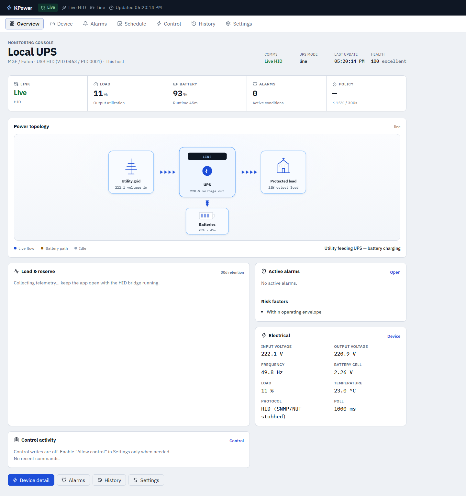
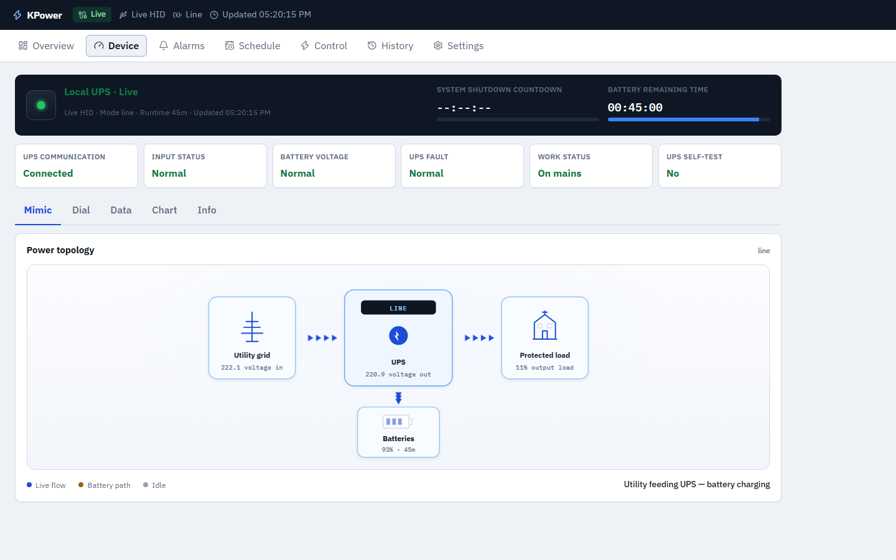
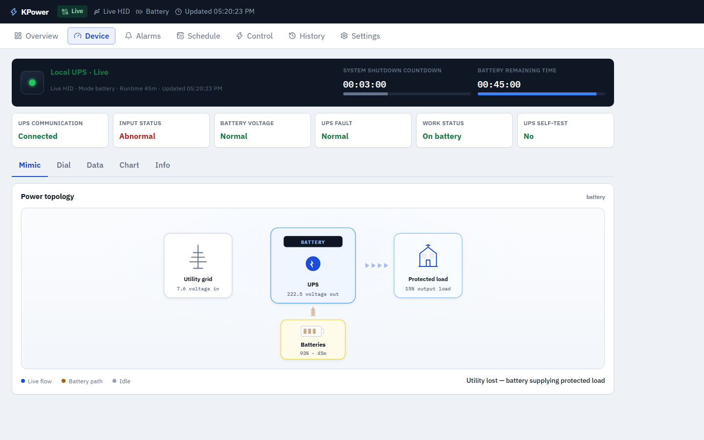
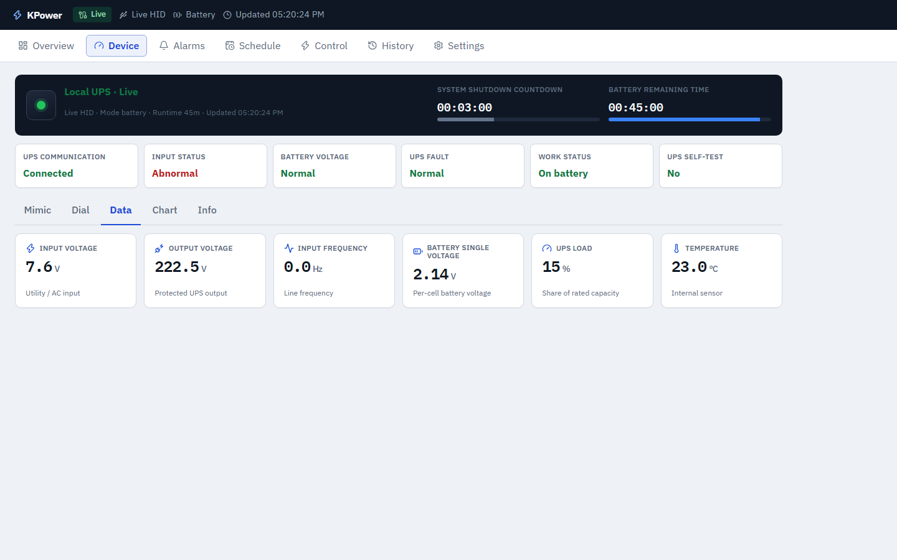
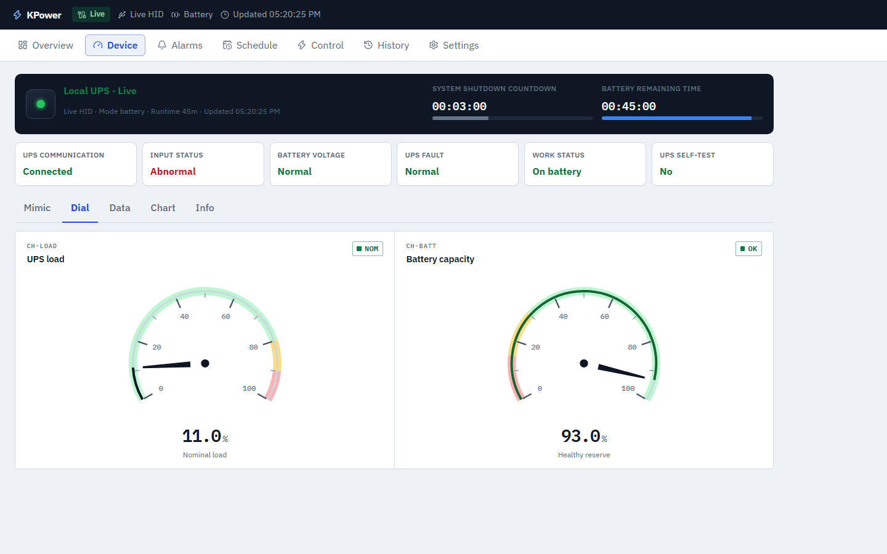
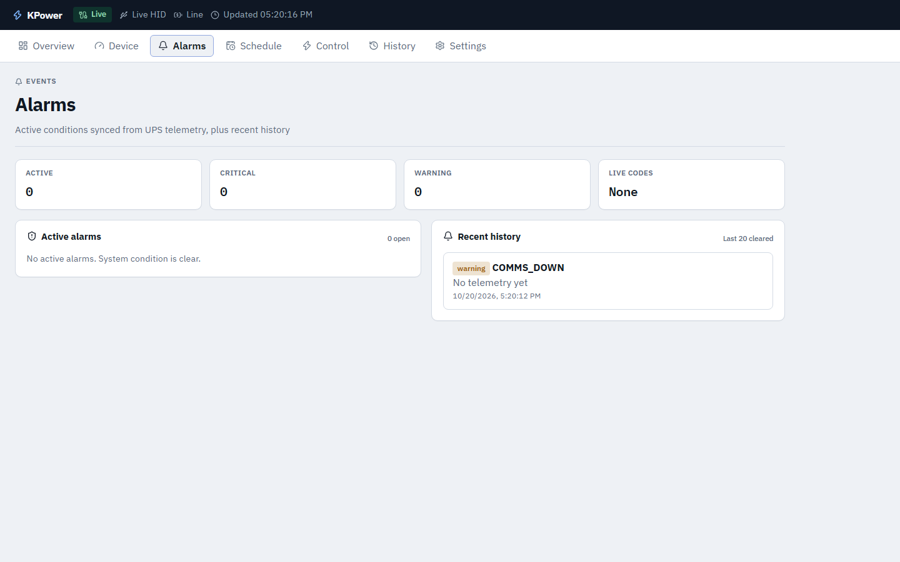
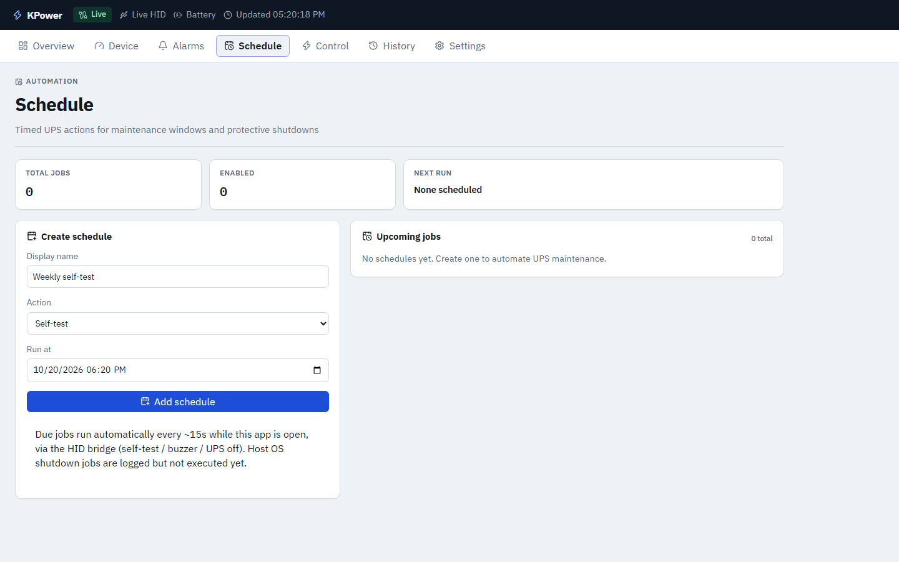
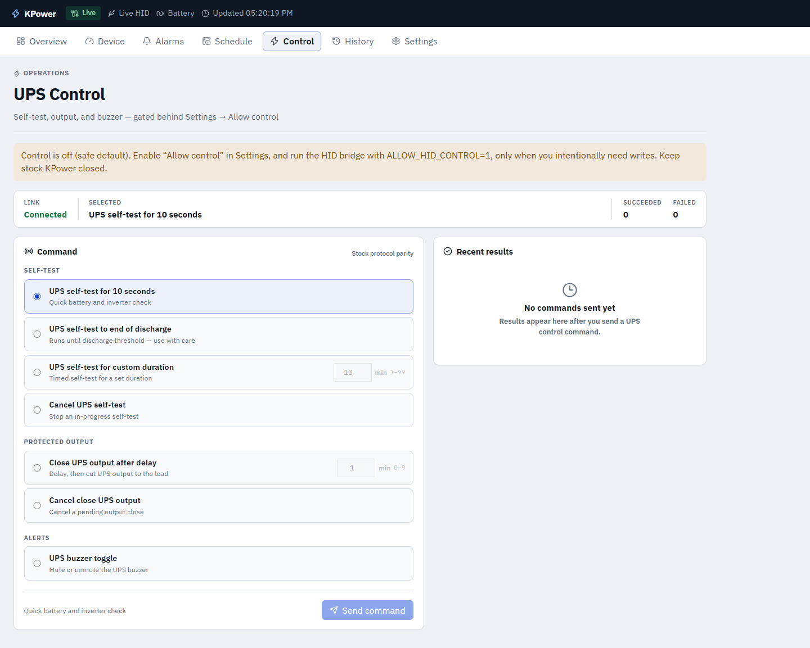
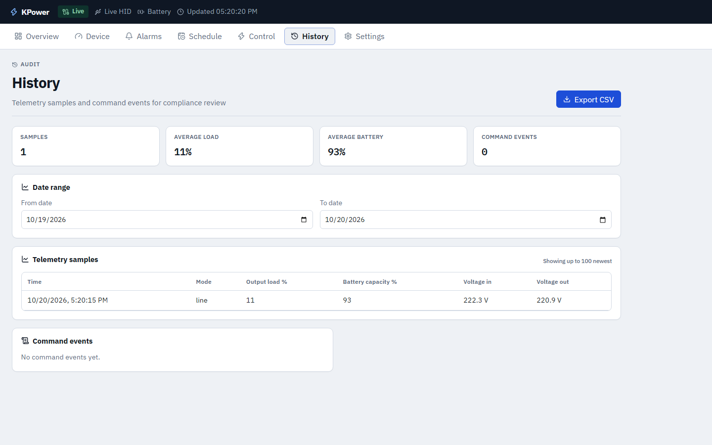
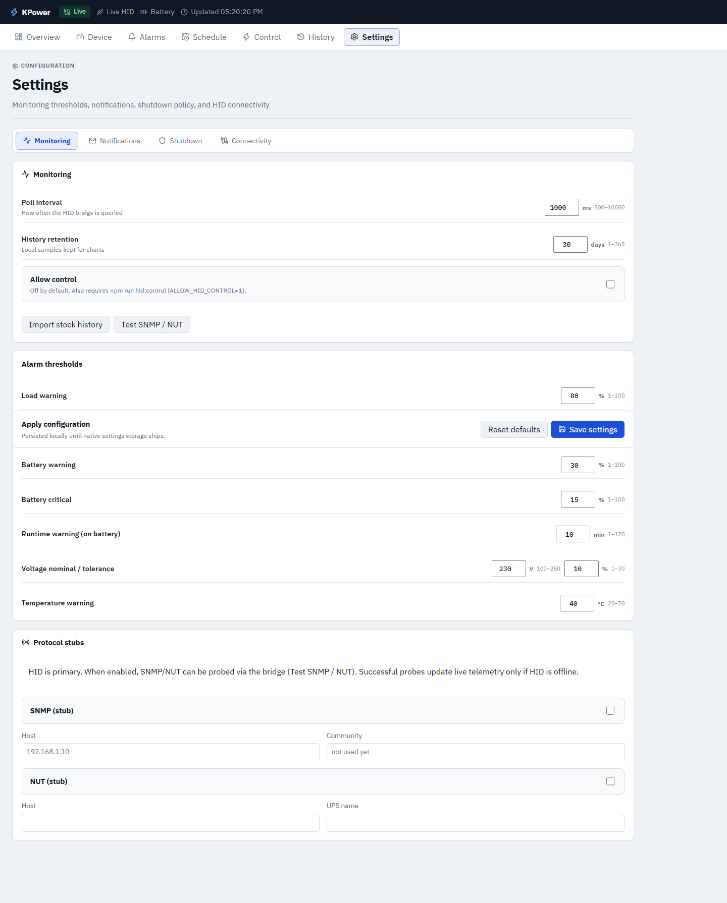

# KPower

[](LICENSE)
[](kpower-app)

Enterprise-minded **Windows UPS monitoring console** for MGE / Eaton USB HID devices (`VID 0463` / `PID 0001`).

React + Vite ops UI backed by a local Node HID bridge. **Real telemetry only** — no simulator in the live path. Control writes are **off by default**.

| Service | URL |
|---------|-----|
| Web UI | http://127.0.0.1:1420/ |
| HID bridge | http://127.0.0.1:3921/health |
| Source | [`kpower-app/`](kpower-app/) |

---

## Screenshots

### Overview


### Device


| Mimic | Data | Dial |
|:-----:|:----:|:----:|
|  |  |  |

### Alarms · Schedule · Control




### History · Settings



---

## Features

- **Comms honesty** — live / stale / disconnected / bridge-down (never fake zeros)
- Overview power topology, Device mimic / data / instrument dials
- Configurable alarm thresholds; schedule jobs; gated Megatec control
- SMTP, Telegram, webhook alerts + Telegram bot (`/status`, `/voltage`, …)
- Always-on Windows background service (HID + UI)
- Stock `kpower.db` history import
- All-in-one Windows installer (Inno Setup + bundled Node)

See [docs/ARCHITECTURE.md](docs/ARCHITECTURE.md) · [CHANGELOG.md](CHANGELOG.md) · [SECURITY.md](SECURITY.md)

---

## Quick start

**Prerequisites:** Windows 10/11, [Node.js](https://nodejs.org/) 20+, USB UPS attached.  
**Important:** close stock KPower first — USB HID is exclusive.

```powershell
git clone https://github.com/HasanR3/kpower.git
cd kpower/kpower-app
npm install
npm run service:install   # elevates once — starts HID + UI in background
```

Open **http://127.0.0.1:1420/**

### Manual (two terminals)

```powershell
npm run hid    # bridge on :3921
npm run dev    # Vite UI on :1420
```

### Background service

| Command | Purpose |
|---------|---------|
| `npm run service:install` | Register `KPowerMonitor` (logon + every 5 min) |
| `npm run service:start` | Start HID + UI now |
| `npm run service:uninstall` | Remove task and stop listeners |

---

## Control safety

UPS output / self-test commands can disrupt loads.

1. Settings → enable **Allow control**
2. `npm run hid:control` (sets `ALLOW_HID_CONTROL=1`)
3. Control page → confirm destructive actions

Leave control **off** for monitoring-only fleets.

---

## Installer

```powershell
cd kpower-app
npm run installer:build
# → release/KPower-Setup-0.1.0.exe  (UI + bridge + Node)
```

Unsigned builds may be blocked by **Smart App Control**. Options: turn SAC off for install, Authenticode-sign the EXE, or run `npm run installer:install` (SAC-safe file copy). Details: [kpower-app/PACKAGING.md](kpower-app/PACKAGING.md).

---

## Status & limitations (0.1.0)

| Area | Status |
|------|--------|
| HID telemetry + Megatec control path | Production-ready (gated) |
| Notifications (SMTP / Telegram / webhook) | Ready when configured |
| Background HID + UI | Ready (`KPowerMonitor`) |
| Host OS auto-shutdown | **Configured in UI — not fully executed yet** |
| SNMP / NUT | Secondary probes only (HID is primary) |
| Native Tauri MSI | Optional; may fail under enterprise WDAC |
| Code-signed installer | Not included (bring your own cert) |

---

## Tests

```powershell
cd kpower-app
npm test        # Vitest unit
npm run test:e2e
npm run build
```

---

## Security & secrets

- Bridge binds **loopback only** (`127.0.0.1`)
- Telegram / SMTP secrets live in AppData + `localStorage` — **never commit them**
- Report vulnerabilities privately — see [SECURITY.md](SECURITY.md)

---

## Contributing

See [CONTRIBUTING.md](CONTRIBUTING.md). PRs welcome for docs, tests, and safe monitoring features.

## License

[MIT](LICENSE) © KPower contributors

> Unofficial monitoring console compatible with MGE/Eaton Megatec USB HID UPS devices. Not affiliated with Eaton or the stock KPower vendor.
